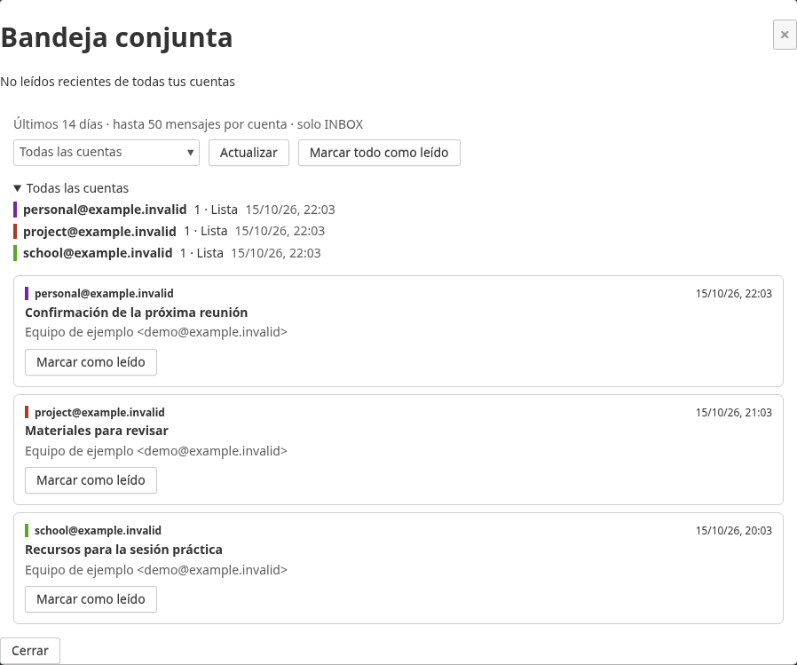
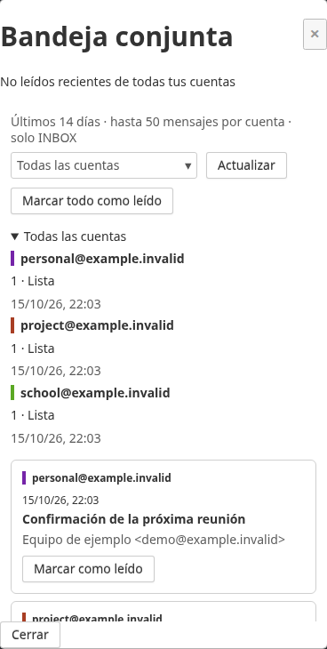

# Unified Inbox / Bandeja conjunta

SnappyMail plugin showing recent **unread INBOX messages** from the main account
and its configured additional accounts. No core modifications. AGPL-3.0.
Developed against SnappyMail **2.38.2**; compatibility with other versions is unverified.

## English

Open **Unified inbox** in the folder sidebar. Accounts load independently (two
concurrent requests), and messages appear newest first. Filter by account or
press **Refresh** to bypass the metadata cache. Connection errors are shown per
account without hiding results from the others. Click a message to switch to
its account and open SnappyMail's normal viewer.

Use **Mark as read** below a message to mark it in its own account without opening
it or switching accounts. The row disappears and its displayed account count
updates only after the server confirms the read flag. On error the row stays
visible; refresh and retry. This action synchronizes with other IMAP clients.

**Mark all as read** applies to the current visible list and respects the account
filter and date/count limits. A confirmation states the account scope and message
count. Progress and the final success/failure counts appear in the panel; failed
messages stay visible. Closing the panel stops scheduling further messages;
requests already in flight can still complete. Messages outside the current view
are not included. The button is disabled while loading or when the view is empty.

Defaults: last 14 days, up to 50 messages per account, 180-second cache. These
limits are visible in the panel; this is not an exhaustive view of all mail or
all unread messages. The per-account cap takes the highest UIDs (most recently
added messages), then orders the displayed results by IMAP INTERNALDATE.
Dates use the server's IMAP SINCE semantics (calendar-day precision).

Listing uses EXAMINE and metadata FETCH and does not mark mail as read. Opening
a message follows SnappyMail's configured read behavior. UIDVALIDITY is checked
before reusing a UID; an exact, unique Message-ID match is the fallback. Moved,
deleted or ambiguous messages report an error; other folders are not searched.

### Install

Copy this repository's files into the **unified-inbox** directory under your
SnappyMail data directory's `_data_/_default_/plugins/`, or mount the source there
read-only. Enable plugins and **Unified Inbox** in administration. Keep the
directory name `unified-inbox` so SnappyMail can discover `UnifiedInboxPlugin`.

The admin plugin options are `days` (1–365), `limit` (1–200), and `ttl` (0–900
seconds; zero disables cache reuse). Defaults are 14, 50, and 180.

Metadata is stored under `APP_PRIVATE_DATA/unified-inbox/` with owner/account
hashes, directory mode 0700 and file mode 0600. It contains sender, subject,
Message-ID, UID, mailbox generation and timestamps, **no bodies or credentials**.
Protect and exclude this directory from public/static serving and unencrypted
backups. Expired entries are removed on access; old account entries are cleaned
up opportunistically when that owner uses the plugin. Account permission is
checked before cache access, even when the data is cached.

When switching accounts, only the destination identifiers are held in the tab's
sessionStorage. They are consumed after reload, rejected after two minutes, and
the active account is checked again. Refresh always rechecks live IMAP state;
opening invalidates the account cache, and normal message opening schedules
another invalidation after 15 seconds. Other clients' changes can remain visible
until refresh or cache expiry. Opening a message during loading stops scheduling
the remaining accounts; reopen or refresh the panel to resume the full view.

No SMTP calls, notifications, telemetry or new authentication system.

### Development

```sh
php -l index.php
php tests/cache.php
php tests/backend.php
node --check unified-inbox.js
node tests/ui.cjs
```

The browser integration test requires Playwright, Chromium and a configured test
installation; see `tests/browser.py`. It uses existing credentials internally,
verifies that listing leaves unread flags unchanged, and uses already-read
messages to test opening in the main and an additional account. It sends no mail,
saves no real-mail screenshots and omits private response/exception details.
`tests/demo.py` renders screenshots using synthetic metadata without logging in.

Set `UNIFIED_INBOX_URL`, `UNIFIED_INBOX_MAIN_EMAIL`,
`UNIFIED_INBOX_PASSWORD_FILE` (existing protected file, first line only),
`UNIFIED_INBOX_SECONDARY_EMAIL`, and `UNIFIED_INBOX_SECONDARY_PASS_ENTRY`
(existing entry in the `pass` password manager) before running the browser test.
Optional IMAP hosts: `UNIFIED_INBOX_IMAP_HOST` (default `imap.gmail.com`) and
`UNIFIED_INBOX_SECONDARY_IMAP_HOST` (defaults to the main host). Test accounts
must have INBOX messages already marked read and the webmail UI must use Spanish.
Set `UNIFIED_INBOX_CHECK_SEGUIMIENTO=1` to also verify the existing Seguimiento
sidebar button on installations that have that plugin. The observed validation
and its limits are recorded in [docs/VERIFICATION.md](docs/VERIFICATION.md).
Use `python3 tests/browser.py --mark-read-only` for the focused read-flag test;
it uses messages already read, preserving existing unread messages.

## Español

**Bandeja conjunta** aparece en la barra de carpetas. Reúne los no leídos
recientes de INBOX de la cuenta principal y sus cuentas adicionales, con carga
progresiva, filtro por cuenta y errores independientes. **Actualizar** consulta
los servidores aunque exista caché. Al pulsar un mensaje se abre en su cuenta.

Cada mensaje incluye **Marcar como leído**: actúa en su propia cuenta sin abrir
el correo ni cambiar de cuenta. Tras confirmarlo el servidor, desaparece de la
lista y se actualiza el contador. Si falla, permanece visible para reintentar.

**Marcar todo como leído** actúa sobre los mensajes visibles y respeta el filtro
de cuenta y los límites de fecha y cantidad. Antes de empezar pide confirmación
con el número de mensajes y la cuenta seleccionada. Muestra el progreso y conserva
los mensajes que no se puedan marcar. Al cerrar el panel se dejan de iniciar
operaciones nuevas; las que ya estén en curso pueden terminar.

Por defecto muestra los últimos **14 días**, hasta **50 mensajes por cuenta**,
con una caché de **3 minutos**. Los límites se indican en el panel. Consultar la
lista no marca correos como leídos; abrirlos conserva el comportamiento normal
de SnappyMail. Si un mensaje se ha movido o eliminado, actualiza la bandeja.

Instala el contenido en la carpeta de plugins `unified-inbox` y actívalo desde
administración. Allí puedes ajustar días, cantidad y duración de la caché.
La interfaz está disponible en español, inglés y catalán.

La caché contiene metadatos privados, nunca cuerpos ni contraseñas; se guarda
fuera del código con permisos restrictivos. No publiques su contenido.




